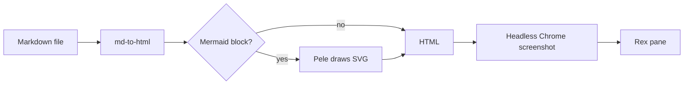

# Viewer test page

A page to judge the pane viewer: GitHub-flavored Markdown, with a diagram drawn by Pele.

## Diagram



## Text

Plain text with **bold**, *italic*, ~~struck~~, `inline code`, and a [link](https://github.github.com/gfm/).

> A block quote, for a note worth setting apart.

## Lists

- [x] Images accepted by Rex
- [x] Long documents placed in strips
- [ ] Fit the pane and follow the terminal theme

1. First
2. Second
   - Nested item

## Table

| Part     | Tool            | Time    |
| -------- | --------------- | ------: |
| Markdown | marked          |   20 ms |
| Diagrams | Pele            |   30 ms |
| Picture  | headless Chrome |  300 ms |

## Code

```ts
export function rows(heightPx: number, cellPx: number): number {
  return Math.ceil(heightPx / cellPx);
}
```

---

End of the test page.
